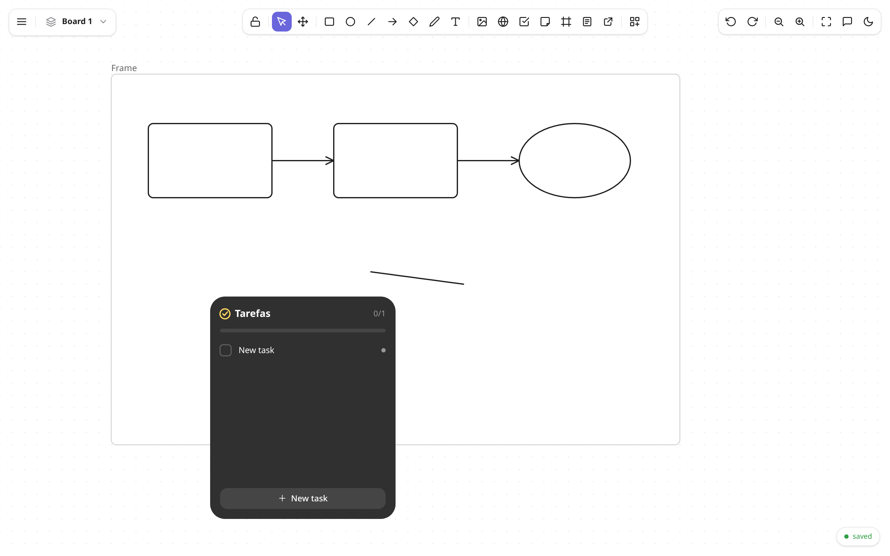

# OmniBoard

Open source infinite canvas whiteboard application and modular engine. OmniBoard is built in two distinct layers: a standalone, framework-agnostic TypeScript engine based on Canvas 2D, and a full-featured web application with a Go backend.



```
packages/core   TypeScript engine on Canvas 2D (zero runtime dependencies)
packages/react  React component wrapper and hooks
apps/web        Web application (React SPA)
apps/api        Backend service (Go, Fiber, PostgreSQL)
examples/       Static engine demonstration
```

---

## Features

### Canvas
* Infinite pan and zoom navigation.
* Standard shapes: rectangle, ellipse, line, arrow, freehand drawing, text.
* 16 structured diagram shapes: diamond, cylinder, cloud, star, flowchart nodes, and related icons.
* Interactive board elements: sticky notes, frames, task cards, images, iframe embeds, notes with modal editors, and board link shortcuts.

### Editing & Manipulation
* Multi-element selection, translation, resizing, and rotation.
* Smart snapping alignment with dynamic visual guides.
* Connected arrows that bind to elements and update automatically.
* History management: multi-level undo and redo.
* Clipboard operations: copy, cut, paste, and duplicate.
* Layer management: bring to front, send to back, and z-order controls.
* Theme and appearance customization: light and dark themes, grid patterns, and stroke styling.

### Collaboration & Sharing
* Contextual canvas comments with threaded replies and resolution states.
* Read-only public share links with cryptographic token validation.

### Persistence & Storage
* Versioned JSON snapshots and per-element delta tracking.
* Pluggable persistence adapters (local storage, memory, remote backend).
* Multi-board workspace management with tabbed document switching.
* Cloud storage support for uploaded assets via S3-compatible object storage (such as Cloudflare R2).

---

## Getting Started

### Prerequisites
* Node.js 22+
* pnpm 9+
* Go 1.24+ (backend only)
* Docker (PostgreSQL database only)

### Installation & Local Development

1. Clone the repository:
   ```bash
   git clone https://github.com/FehFernandes/omniboard.git
   cd omniboard
   ```

2. Install dependencies and build internal packages:
   ```bash
   pnpm setup
   ```

3. Start the web application:
   ```bash
   pnpm dev
   ```
   The application runs at `http://localhost:5173`. In standalone mode, boards are persisted locally in the browser.

### Backend Setup (Optional)

To enable accounts, remote synchronization, share links, and image uploads:

1. Start the PostgreSQL container:
   ```bash
   pnpm db:up
   ```

2. Configure environment variables:
   ```bash
   cp apps/api/.env.example apps/api/.env
   ```

3. Start the API server:
   ```bash
   pnpm dev:api
   ```
   The API runs at `http://localhost:4000`. Refer to [docs/setup.md](docs/setup.md) for full configuration details.

---

## Modular Engine Architecture

The core canvas engine (`packages/core`) and the React wrapper (`packages/react`) are architected as decoupled packages with zero application-level dependencies.

### Direct Engine Usage

```ts
import { Board } from "@omniboard/core";

const container = document.getElementById("app")!;
const board = new Board(container, { grid: true });

board.setTool("rectangle");
board.on("change", ({ elements }) => {
  console.log("Elements updated:", elements);
});

const snapshot = board.getSnapshot();
board.loadSnapshot(snapshot);
```

### React Component Usage

```tsx
import { OmniBoard, useBoard } from "@omniboard/react";

function App() {
  const boardState = useBoard();

  return (
    <div style={{ position: "fixed", inset: 0 }}>
      <button onClick={() => boardState.setTool("rectangle")}>
        Rectangle Tool
      </button>
      <OmniBoard
        onReady={boardState.ready}
        onChange={boardState.onChange}
        grid
      />
    </div>
  );
}
```

Detailed engine documentation covering tools, element definitions, event subscriptions, and plugins is available in [packages/core/README.md](packages/core/README.md).

---

## Project Commands

| Command | Description |
| :--- | :--- |
| `pnpm setup` | Installs dependencies and builds engine packages |
| `pnpm dev` | Starts the web application development server |
| `pnpm dev:api` | Starts the Go API server |
| `pnpm dev:lib` | Builds library packages in watch mode |
| `pnpm test` | Runs the test suite across libraries, web app, and API |
| `pnpm e2e` | Runs Playwright end-to-end browser tests |
| `pnpm check` | Runs full validation (type checking, linting, and tests) |
| `pnpm build` | Generates production builds for libraries and web application |

---

## Contributing

Please review [CONTRIBUTING.md](CONTRIBUTING.md) for guidelines on development workflows, architectural rules, code conventions, and pull request submissions.

To report security vulnerabilities, follow the process defined in [SECURITY.md](SECURITY.md).

---

## License

This project is licensed under the [MIT License](LICENSE).
